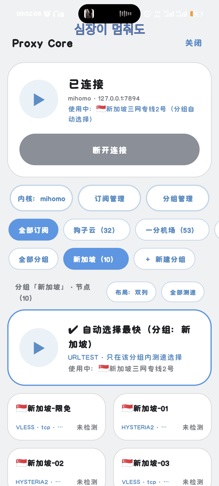

[✈️ 一分机场 便宜量大 三网均衡](https://xn--4gqx1hgtfdmt.com/#/register?code=Ife7C7AX)

[🛩️ 吹雪云 比良心良心的机场](https://xn--9kqs1lo79d.com/#/register?code=84TM9zSm)

月付通通低至两月🎉好吃😋不贵量大管饱

插件实况

# Proxy Core

给支持 Python 插件的 Android Telegram 客户端使用的代理插件。内置 mihomo 与 sing-box 双核心，可在插件内安装核心、管理订阅、连接代理、筛选节点并进行延迟检测。

> **版本：3.4.4**  
> 插件代码已完成语法检查；不同客户端的插件 API 和运行环境可能有差异，当前版本尚未在所有目标客户端上完成实机验证。

## 功能

- **双核心**：可选择 mihomo 或 sing-box；同一客户端进程中只加载一种核心。
- **核心安装与更新**：从本项目 GitHub Releases 下载 Android arm64 核心，并校验 SHA-256。
- **订阅管理**：添加、编辑、删除多个订阅或手动节点链接，并可单独更新订阅。
- **自动选择**：支持按订阅、节点分组筛选；同时选择订阅和分组时取交集，仅在筛选结果内自动测速选择。
- **本地切换**：启动时预建订阅、分组及其组合自动组。切换筛选时调用本地控制 API，不重新下载订阅或重启核心。
- **延迟检测**：支持单节点检测和全部测速；失败或无有效延迟的节点显示 `timeout`。
- **配置备份与恢复**：入口在插件设置主页，不在控制中心面板。备份复制到系统剪贴板，恢复时从剪贴板读取并校验 JSON。
- **恢复原代理设置**：停止核心时恢复连接前 Telegram 的代理设置。
- **仅供 Telegram 使用**：代理入站监听 `127.0.0.1`，不创建 VPN / TUN。

## 快速开始

### 安装插件

将 `proxy_core.plugin` 安装到支持 Python 插件的客户端。插件元数据要求客户端版本 `>=12.0.0`；具体兼容性以目标客户端的插件 API 为准。

### 安装并连接

1. 打开插件设置页，点击“打开控制面板”。也可以通过侧边栏的“代理控制面板”打开。
2. 在控制面板中选择 mihomo 或 sing-box，并点击“安装组件”。
3. 打开“订阅管理”，添加订阅地址或节点分享链接。
4. 点击“连接”，待节点列表加载后选择节点，或使用自动选择。
5. 不使用时点击“断开连接”，插件会停止核心并恢复 Telegram 原有代理设置。

首次安装核心需要能够访问 GitHub Releases。核心文件不包含在插件文件中。

## 自动选择和筛选

控制面板中的订阅标签和分组标签可组合使用。例如先选某个订阅，再选“新加坡”分组，列表只显示同时属于该订阅和该分组的节点，自动选择也只在这些节点中进行。两个筛选条件可以任意顺序设置。

核心启动时会预建订阅、分组及其组合自动组。之后切换筛选只切换本地代理目标，不会重新下载订阅。修改或新增节点分组后，需要重新应用内核配置，插件会在保存分组时处理。

单节点测速与自动选择是不同检测路径：自动选择使用内核的 URL-test 组，界面测速通过本地控制 API 请求节点延迟。因此界面测速显示 `timeout` 不一定代表自动选择组没有可用检测结果。

## 订阅格式与核心差异

| 项目 | mihomo | sing-box |
| --- | --- | --- |
| 订阅处理 | 由内核代理提供者读取 | 插件下载并转换为出站配置 |
| Clash YAML | 支持范围取决于订阅和 mihomo 解析能力 | 不支持，需使用通用分享链接订阅 |
| 节点类型 | 由 mihomo 核心支持的类型 | 插件转换器支持常见 VMess、VLESS、Trojan、Shadowsocks、Hysteria2、TUIC 等类型；具体参数兼容性依节点而异 |
| 自动测试 | 内核 URL-test | 内核 URL-test |

如果订阅提供 Clash YAML，优先选择 mihomo。sing-box 模式需要插件能解析订阅中的通用节点链接。

## 配置备份与恢复

在插件设置主页的“配置”区域使用“备份配置到剪贴板”和“从剪贴板恢复配置”。备份内容包括订阅/手动节点、分组、核心类型、本地端口、布局、自动连接状态及当前筛选和选择状态。

恢复操作会覆盖对应插件配置。恢复前请确认剪贴板中是可信的 Proxy Core 备份 JSON；插件会检查备份标识及主要字段。核心未运行时，恢复后需要打开控制面板连接；核心运行时会尝试重新应用配置。

## 端口与连接行为

- 代理端口默认从 `7890` 开始，若端口被占用会顺延寻找可用端口；设置页的本地端口用于指定起始端口。
- 控制端口从 `19090–19099` 中选择可用端口。
- 控制 API 使用插件配置的鉴权密钥；代理流量入口绑定 `127.0.0.1`。
- 本插件不配置系统 VPN/TUN，也不负责设备上其他应用的代理。

## 构建核心

仓库中的 `.github/workflows/build-cores.yml` 用于构建并发布 mihomo 与 sing-box 核心。工作流产物包括压缩后的核心库及其 SHA-256 校验文件。插件从仓库 Releases 获取核心；更改核心构建方式或仓库地址时，应同步检查插件中的 `CORE_REPO` 和发布文件名。

## 常见问题

**安装组件失败怎么办？**  
检查网络是否可以访问 GitHub Releases，并确认仓库中存在插件所需的核心文件和 SHA-256 文件。若仍失败，查看插件日志中的下载或校验错误。

**sing-box 更新订阅后没有节点？**  
确认订阅提供的是插件支持解析的通用节点链接，而不是 Clash YAML。Clash YAML 订阅请改用 mihomo。

**切换订阅或分组时为什么不需要更新订阅？**  
核心启动时已经预建可用的自动组，筛选切换通过本地控制 API 完成。新增或修改节点分组属于配置变更，需要重新应用配置。

**测速显示 `timeout`，但自动选择仍在切换？**  
界面测速和内核自动选择使用不同的检测路径。API 请求失败或超时会让界面显示 `timeout`，不一定能代表自动组的检测结果。

**停止后 Telegram 代理会怎样？**  
插件会停止核心，并恢复连接前保存的 Telegram 代理设置。若客户端被强制结束，恢复动作可能无法执行；重新打开客户端后检查代理状态。

**能否让两个核心同时运行并直接热切换？**  
当前不能。核心以原生库加载到客户端进程，同一进程只使用一个核心；切换核心时需要先停止当前核心，并可能需要按客户端提示重启。

## 已知限制

- 面向 Android 客户端；核心构建与插件接口以仓库实际发布内容为准。
- 不同客户端的 Python 插件 API 可能存在差异，需在对应客户端版本上验证。
- sing-box 不支持 Clash YAML 订阅；复杂或非标准分享链接可能无法解析。
- 运行中的订阅/节点配置与核心能力、节点服务端兼容性有关，不保证所有节点都可连接。
- 插件设置页备份使用系统剪贴板，不生成独立备份文件。

## 安全说明

核心是原生代码并加载在 Telegram 客户端进程中。请只从可信仓库获取插件和核心，并注意保护订阅地址及节点链接。备份 JSON 可能包含订阅 URL、节点凭据和筛选配置，不要公开分享。控制 API 用于本机控制核心；不要将控制端口暴露到不可信网络。

## 致谢

- [mihomo](https://github.com/MetaCubeX/mihomo)
- [sing-box](https://github.com/SagerNet/sing-box)
- 核心构建及发布：[miludekuaidi/bettsocks](https://github.com/miludekuaidi/bettsocks)

## 许可

请按仓库实际许可证补充本项目许可信息。mihomo 与 sing-box 及其依赖各自遵循上游许可证；分发构建产物前请确认并遵守对应许可要求。
